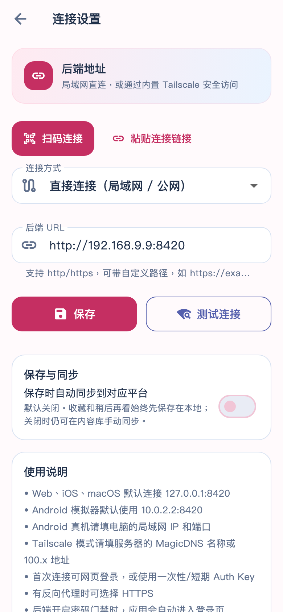

# 后端扫码连接

连接流程：电脑 Web / 插件「手机版」→ 选择局域网、Tailscale 或公网地址 → App 连接设置「扫码连接」→ 自动保存并重连。二维码也可用手机相机打开 Mobile Web。

| 二维码 | App 保存的后端 | 连接方式 |
| --- | --- | --- |
| `http://192.168.1.7:8420/m/` | `http://192.168.1.7:8420` | 直接连接，同一局域网 |
| `http://100.100.1.2:19090/m/` | `http://100.100.1.2:19090` | 直接连接，手机系统 Tailscale 已启用 |
| `http://100.100.1.3:8421/m/?obc_connection=tailscale` | `http://100.100.1.3:8421` | App 内置 Tailscale，同一 tailnet |
| `https://obc.example.com/prefix/m/` | `https://obc.example.com/prefix` | 直接连接，保留 HTTPS 与代理路径 |

解析入口 `BackendConnectionLink.parse()`：只接受 HTTP(S)，拒绝回环、通配监听地址与 URL 用户名密码，移除 `/m/`、`/web/`、`/api/` 入口后缀及查询 / fragment，保留其他路径前缀和端口；`obc_connection=tailscale` 明确选择 App 内嵌连接，普通系统 Tailscale 地址保持直接连接。参数不包含登录凭据。旧版电脑二维码的普通 `/m/` 链接也能导入。

`SettingsView` 使用同一解析器处理相机和粘贴链接，再通过既有 `ApiClient.saveSettings()` 持久化、清理旧后端会话并重启推荐轮询。扫码应用内节点时先复用现有 Tailnet 连接 / 网页登录流程；成功后自动保存，入网失败时保留已填地址和原客户端设置。已有后端密码门禁继续生效；扫码不等于已通过业务登录校验。

相机页 `BackendScanView` 仅在 Android / iOS 展示入口，使用 `mobile_scanner` 7.4.2 在设备本地识别 QR，切到后台停止相机，返回后恢复；离开页面释放控制器。iOS 增加 `NSCameraUsageDescription`，Android 声明 CAMERA 且相机硬件非必需。拒绝权限、没有相机或其他平台可用「粘贴连接链接」，手动地址入口继续保留。插件用默认随包 Android MLKit，不要求手机首次下载识别模型。

数据流：

```text
desktop Web / extension HTTP(S) QR → device camera → local QR decoder
                                            ↓
paste link ─────────────────────→ BackendConnectionLink.parse
  → ApiClient.saveSettings (direct / embedded Tailscale) → polling reconnect
  → existing backend authentication
```

验证：`flutter analyze`、`flutter test`；新增 `backend_connection_link_test.dart` 覆盖地址与非法输入，`settings_qr_connection_test.dart` 覆盖扫描回执 → 保存 → 重连 → 重启恢复；原有 `settings_backend_url_test.dart` 继续验证手动输入。相机实拍和真实跨设备 Tailnet 连通性需要设备验收，不能由 widget mock 替代。后端 / 插件需使用配套新版本，源代码分支完成不代表商店或安装包已更新。

官方组件说明：[mobile_scanner](https://pub.dev/packages/mobile_scanner)。

## 本次验证（2026-10-26）

- `flutter analyze`：通过；`flutter test`：179 项通过。
- 扫码连接 7 项通过，含取消、无效扫码、首次 Tailnet 入网和登录未完成时保留旧后端；原有手动配置回归继续通过。
- iOS simulator / Android debug 原生构建通过；相机 purpose string 已在编译后的 iOS `Info.plist` 中确认。
- `flutter test integration_test/backend_qr_decode_test.dart -d macos`：原生解码测试通过。固定 PNG 来自后端 / 插件实际 JS QR 编码器，覆盖五类链接和 v5 / v10。该测试不打开相机；`mobile_scanner` 明确不支持 iOS 模拟器图片分析，应使用 macOS、Android 或 iOS 真机。
- 未执行手机相机实拍和真实跨设备 / tailnet 网络验收；未发布新商店或安装包版本。

## 真实请求验收入口（2026-10-27）

`integration_test/backend_qr_live_test.dart` 是显式选择运行的真实后端测试：从电脑实际二维码 DOM 导出的 PNG 经原生解码后，由真实 `SettingsView` 接收结果，使用真实存储保存配置，再通过实际 `RecommendProvider` / `ApiClient` 请求推荐、轻量连通性，并用新客户端加载已保存设置再次 ping。除了自动模式用扫码回执适配器传递已原生解码的字符串，不替换 HTTP、存储或 Tailnet 服务；此模式不验证相机光学拍摄。

测试结束还原原来的连接偏好和安全存储项；不执行 Tailnet logout，也不删除已有节点身份。入网需要原有有效身份或用户完成正常登录。业务请求可能记录推荐展示，因此应优先指向真实数据库的隔离快照，避免污染日常使用记录。

运行时将真实二维码保存在仓库外，通过 `--dart-define-from-file=/private/path/qr-defines.json` 传入 `OBC_LIVE_QR_CASES`。该值是 JSON 数组的字符串，每项包含 `label`（非敏感标签）、`url`（实际扫码 URL）、`png`（同一二维码 PNG 的 base64）；不传参数时跳过，不能记为通过。

```bash
# Android / macOS / iOS 真机；图片分析不支持 iOS 模拟器。
flutter test integration_test/backend_qr_live_test.dart -d <device-id> \
  --dart-define-from-file=/private/path/qr-defines.json

# iPhone 无线调试需要 drive 入口和本地网络权限。
flutter drive --driver=test_driver/backend_qr_live.dart \
  --target=integration_test/backend_qr_live_test.dart -d <iphone-id> \
  --publish-port --dart-define-from-file=/private/path/qr-defines.json

# 无前台窗口的 macOS：原生解码 + 真实保存 / HTTP，明确排除 SettingsView UI。
flutter test integration_test/backend_qr_live_test.dart -d macos \
  --dart-define=OBC_LIVE_QR_TRANSPORT_ONLY=true \
  --dart-define-from-file=/private/path/qr-defines.json

# 手机网页：设备 WebView 实际加载二维码 URL，等待真实推荐卡片渲染。
flutter test integration_test/mobile_web_connection_live_test.dart -d <device-id> \
  --dart-define-from-file=/private/path/qr-defines.json
```

`OBC_LIVE_QR_CAMERA=true` 切换真实相机页面，需要用户实际对准二维码并允许相机权限；不能用于无人值守通过。iOS 截图由专用 driver 保存到忽略的 `build/qr-live-acceptance/`。PNG / 私有地址 / 日志不提交仓库。模拟器 WebView 不等于实体手机浏览器；同机两个 Tailscale 节点也不等于跨蜂窝网络。

本轮实体 iPhone（iOS 18.5）已签名构建并安装，但无线调试未发现 Dart VM；Flutter 提示本地网络权限 / Xcode 自动化授权。已请求用户处理系统权限，不能记为真机通过。macOS 自动测试原生解码已成功，但前台窗口未激活，完整 UI 步骤未判为通过；使用上述 transport-only 模式分别记录链路能力。完整网络实测见后端 `docs/verification/2026-10-27-mobile-connection-live.md`。

本轮 transport-only、Android 和 iOS WebView 后续运行因本机内存 / swap 压力停止，均没有完成测试，不能标为通过。已停止本次构建与模拟器。三个新增 Dart 文件最终 `flutter analyze` 无问题；后端真实 HTTP / 共享二维码模块的独立联测为 1 passed（35.21 秒），覆盖实际 LAN / 系统 Tailscale IPv4 的资源、健康和推荐响应，不能据此替代原生 UI 或相机验收。

真实请求进一步复现连接误判：`/ping` 约 21 ms，`/health` 首次约 15091 ms、缓存命中约 10 ms，而原 `ApiClient.checkHealth()` 的直连超时只有 5 秒。`checkHealth()` 现在检查 `/api/ping`；只对 404 回退 `/api/health` 兼容旧后端，401 / 403 / 500 或连接异常不会被健康接口回退掩盖，协议、端口、代理前缀与 Tailnet 传输保持相同规则。它检查网络连通，模型就绪仍由后端的 `/health` 表达。新增 `api_client_liveness_test.dart` 先复现两项失败，再验证轻量探测、带路径的旧后端回退与错误状态传播。

修复后相关 API / 设置 / 扫码回归 **30 passed**，`test_e2e/settings_backend_url_live_test.dart` 对同一真实后端复跑 **1 passed**，实际请求保存地址前后的连通性并恢复客户端配置。该轻量脚本的 HTTP 为真实网络，持久化使用隔离替身；不把它当作实体设备存储或 SettingsView UI 通过。最终完整 `flutter analyze` 无问题。此前原生构建成功记录属于二维码功能阶段，本轮 liveness 修复后没有完成新的原生构建。

最终 `flutter test --concurrency=1 --no-pub`：**184 passed**，4 分 22 秒，退出码 0。包含新冷依赖 / 旧后端回退回归；不包含需要显式设备、实际二维码和用户权限的 `integration_test/` 验收。

## 连接设置预览

下图为 390×844 Widget 渲染预览（2026-10-27，测试地址），使用实际设置页与应用浅色主题、本机字体。临时截图测试通过后已移除；不作为真机相机或跨设备网络验收。


