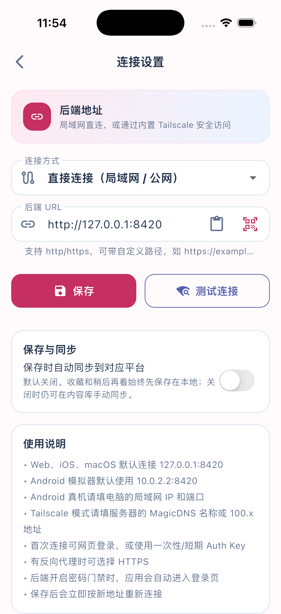
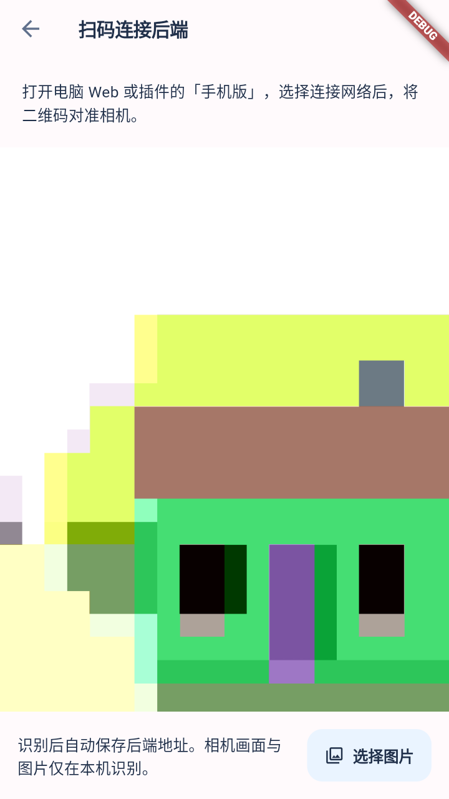

# 后端扫码连接

连接流程：电脑 Web / 插件「手机版」→ 选择局域网、Tailscale 或公网地址 → App 连接设置中后端 URL 右侧的扫码图标 → 相机扫描，或右下角「选择图片」读取二维码截图 → 自动保存并重连。二维码也可用手机相机打开 Mobile Web。

| 二维码 | App 保存的后端 | 连接方式 |
| --- | --- | --- |
| `http://192.168.1.7:8420/m/` | `http://192.168.1.7:8420` | 直接连接，同一局域网 |
| `http://100.100.1.2:19090/m/` | `http://100.100.1.2:19090` | 直接连接，手机系统 Tailscale 已启用 |
| `http://100.100.1.3:8421/m/?obc_connection=tailscale` | `http://100.100.1.3:8421` | App 内置 Tailscale，同一 tailnet |
| `https://obc.example.com/prefix/m/` | `https://obc.example.com/prefix` | 直接连接，保留 HTTPS 与代理路径 |

解析入口 `BackendConnectionLink.parse()`：只接受 HTTP(S)，拒绝回环、通配监听地址与 URL 用户名密码，移除 `/m/`、`/web/`、`/api/` 入口后缀及查询 / fragment，保留其他路径前缀和端口；`obc_connection=tailscale` 明确选择 App 内嵌连接，普通系统 Tailscale 地址保持直接连接。参数不包含登录凭据。旧版电脑二维码的普通 `/m/` 链接也能导入。

`SettingsView` 使用同一解析器处理相机和粘贴链接，再通过既有 `ApiClient.saveSettings()` 持久化、清理旧后端会话并重启推荐轮询。扫码应用内节点时先复用现有 Tailnet 连接 / 网页登录流程；成功后自动保存，入网失败时保留已填地址和原客户端设置。已有后端密码门禁继续生效；扫码不等于已通过业务登录校验。

相机页 `BackendScanView` 仅在 Android / iOS 展示入口，使用 `mobile_scanner` 7.4.2 在设备本地识别 QR，切到后台停止相机，返回后恢复；离开页面释放控制器。右下角独立的「选择图片」按钮通过 `image_picker` 1.2.4 打开系统选图界面，保留原图清晰度并设置 `requestFullMetadata: false`；选图后只让同一控制器分析 QR 格式，结果交给相机共用的地址校验与保存流程。选图期间停止相机、禁用重复选择并忽略旧相机回调；取消或失败后只恢复此前正在运行的相机，不会因取消选图再次请求已拒绝的相机权限，原后端保持不变。相机打开失败不会禁用图片按钮。

iOS 包含 `NSCameraUsageDescription` / `NSPhotoLibraryUsageDescription`；Android 声明 CAMERA 且相机硬件非必需，不新增存储或完整媒体库读取权限。图片和相机画面都不上传；解码后的后端地址继续按既有鉴权流程连接。没有可用相机时可选择图片或粘贴链接，手动地址入口继续保留。插件用默认随包 Android MLKit，不要求手机首次下载识别模型。图片原生解码支持 Android 模拟器与实体 Android / iOS；组件不支持 iOS 模拟器图片分析，因此本轮选图设备验收使用 Android 模拟器。

数据流：

```text
device camera frames ─────────────────┐
image_picker → selected screenshot ───┴→ local QR decoder
                                              ↓
paste link ─────────────────────→ BackendConnectionLink.parse
  → ApiClient.saveSettings (direct / embedded Tailscale) → polling reconnect
  → existing backend authentication
```

验证：`flutter analyze`、`flutter test`；新增 `backend_connection_link_test.dart` 覆盖地址与非法输入，`settings_qr_connection_test.dart` 覆盖扫描回执 → 保存 → 重连 → 重启恢复；原有 `settings_backend_url_test.dart` 继续验证手动输入。相机实拍和真实跨设备 Tailnet 连通性需要设备验收，不能由 widget mock 替代。后端 / 插件需使用配套新版本，源代码分支完成不代表商店或安装包已更新。

官方组件说明：[mobile_scanner](https://pub.dev/packages/mobile_scanner)。

## 本次验证（2026-10-26）

- `flutter analyze`：通过；`flutter test`：179 项通过。
- 扫码连接 7 项通过，含取消、无效扫码、首次 Tailnet 入网和登录未完成时保留旧后端；原有手动配置回归继续通过。
- iOS simulator / Android debug 原生构建通过；相机 purpose string 已在编译后的 iOS `Info.plist` 中确认。
- `flutter test integration_test/backend_qr_decode_test.dart -d macos`：原生解码测试通过。固定 PNG 来自后端 / 插件实际 JS QR 编码器，覆盖五类链接和 v5 / v10。该测试不打开相机；`mobile_scanner` 明确不支持 iOS 模拟器图片分析，应使用 macOS、Android 或 iOS 真机。
- 未执行手机相机实拍和真实跨设备 / tailnet 网络验收；未发布新商店或安装包版本。

## 真实请求验收入口（2026-10-27）

`integration_test/backend_qr_live_test.dart` 是显式选择运行的真实后端测试：从电脑实际二维码 DOM 导出的 PNG 经原生解码后，由真实 `SettingsView` 接收结果，使用真实存储保存配置，再通过实际 `RecommendProvider` / `ApiClient` 请求推荐、轻量连通性，并用新客户端加载已保存设置再次 ping。除了自动模式用扫码回执适配器传递已原生解码的字符串，不替换 HTTP、存储或 Tailnet 服务；此模式不验证相机光学拍摄。

测试结束还原原来的连接偏好和安全存储项；不执行 Tailnet logout，也不删除已有节点身份。入网需要原有有效身份或用户完成正常登录。业务请求可能记录推荐展示，因此应优先指向真实数据库的隔离快照，避免污染日常使用记录。

运行时将真实二维码保存在仓库外，通过 `--dart-define-from-file=/private/path/qr-defines.json` 传入 `OBC_LIVE_QR_CASES`。该值是 JSON 数组的字符串，每项包含 `label`（非敏感标签）、`url`（实际扫码 URL）、`png`（同一二维码 PNG 的 base64）；不传参数时跳过，不能记为通过。

```bash
# Android / macOS / iOS 真机；图片分析不支持 iOS 模拟器。
flutter test integration_test/backend_qr_live_test.dart -d <device-id> \
  --dart-define-from-file=/private/path/qr-defines.json

# iPhone 无线调试需要 drive 入口和本地网络权限。
flutter drive --driver=test_driver/backend_qr_live.dart \
  --target=integration_test/backend_qr_live_test.dart -d <iphone-id> \
  --publish-port --dart-define-from-file=/private/path/qr-defines.json

# 无前台窗口的 macOS：原生解码 + 真实保存 / HTTP，明确排除 SettingsView UI。
flutter test integration_test/backend_qr_live_test.dart -d macos \
  --dart-define=OBC_LIVE_QR_TRANSPORT_ONLY=true \
  --dart-define-from-file=/private/path/qr-defines.json

# 手机网页：设备 WebView 实际加载二维码 URL，等待真实推荐卡片渲染。
flutter test integration_test/mobile_web_connection_live_test.dart -d <device-id> \
  --dart-define-from-file=/private/path/qr-defines.json
```

`OBC_LIVE_QR_CAMERA=true` 使用生产相机页面和实际扫描回调，不创建预分析图片的第二个控制器。实体设备需要实际对准二维码；Android 模拟器可以使用 SDK 软件相机 `-camera-back imagefile:/private/path/frame.png` 输入同一 Web 二维码画面，并显式授予测试 App 相机权限。后者验证模拟器相机帧 → 原生解码 → 生产扫描回调，不代表实体摄像头光学拍摄。必须通过实际预览确认三个定位角及静区完整可见，不能只检查原始 PNG。

相机等待默认 180 秒，可用 `OBC_LIVE_QR_SCAN_TIMEOUT_SECONDS` 显式缩短本轮验收时间。UI 模式使用实时帧策略，记录各阶段并限制单次首帧 / pump 等待；transport-only 模式不创建首帧 UI。客户端从不可达的旧地址开始，扫码后的主机、端口、连接方式必须变化到目标值；恢复阶段先重新读取磁盘偏好再创建客户端，不能把同一进程的新客户端等同于进程重启。

iOS 截图由专用 driver 保存到忽略的 `build/qr-live-acceptance/`。PNG / 私有地址 / 日志不提交仓库。模拟器 WebView 不等于实体手机浏览器；同机两个 Tailscale 节点也不等于跨蜂窝网络。

本轮实体 iPhone（iOS 18.5）已签名构建并安装，但无线调试未发现 Dart VM；Flutter 提示本地网络权限 / Xcode 自动化授权。已请求用户处理系统权限，不能记为真机通过。macOS 自动测试原生解码已成功，但前台窗口未激活，完整 UI 步骤未判为通过；使用上述 transport-only 模式分别记录链路能力。完整网络实测见后端 `docs/verification/2026-10-27-mobile-connection-live.md`。

本轮 transport-only、Android 和 iOS WebView 后续运行因本机内存 / swap 压力停止，均没有完成测试，不能标为通过。已停止本次构建与模拟器。三个新增 Dart 文件最终 `flutter analyze` 无问题；后端真实 HTTP / 共享二维码模块的独立联测为 1 passed（35.21 秒），覆盖实际 LAN / 系统 Tailscale IPv4 的资源、健康和推荐响应，不能据此替代原生 UI 或相机验收。

真实请求进一步复现连接误判：`/ping` 约 21 ms，`/health` 首次约 15091 ms、缓存命中约 10 ms，而原 `ApiClient.checkHealth()` 的直连超时只有 5 秒。`checkHealth()` 现在检查 `/api/ping`；只对 404 回退 `/api/health` 兼容旧后端，401 / 403 / 500 或连接异常不会被健康接口回退掩盖，协议、端口、代理前缀与 Tailnet 传输保持相同规则。它检查网络连通，模型就绪仍由后端的 `/health` 表达。新增 `api_client_liveness_test.dart` 先复现两项失败，再验证轻量探测、带路径的旧后端回退与错误状态传播。

修复后相关 API / 设置 / 扫码回归 **30 passed**，`test_e2e/settings_backend_url_live_test.dart` 对同一真实后端复跑 **1 passed**，实际请求保存地址前后的连通性并恢复客户端配置。该轻量脚本的 HTTP 为真实网络，持久化使用隔离替身；不把它当作实体设备存储或 SettingsView UI 通过。最终完整 `flutter analyze` 无问题。此前原生构建成功记录属于二维码功能阶段，本轮 liveness 修复后没有完成新的原生构建。

此前完整 `flutter test --concurrency=1 --no-pub`：**184 passed**，4 分 22 秒，退出码 0。包含新冷依赖 / 旧后端回退回归；不包含需要显式设备、实际二维码和用户权限的 `integration_test/` 验收。

## iOS 模拟器入口验收（2026-10-27）

入口为 **首页右上角齿轮 → 连接设置 → 后端 URL 输入框最右侧的扫码图标**。旁边的剪贴板图标保留「粘贴连接链接」；两者均收进输入框，不再单独占一排。图标使用标准触控范围，并提供 Tooltip / 无障碍名称。连接方式在窄屏可伸缩，长文字省略，避免撑出屏幕。

`integration_test/backend_qr_ui_test.dart` 在 iPhone 17 Pro / iOS 26.5 模拟器启动实际 `app.main()`，点击首页齿轮，检查真实 URL 输入框内两个图标可见，验证粘贴图标打开对话框并可取消，再点击扫码图标打开 `BackendScanView` 并返回。没有替换设置页、扫描回调、HTTP 或存储，也不改连接地址。默认后端未运行时首页离线，仍可进入连接设置。本次只操作模拟器；这项入口验收不等于光学扫码、联网保存或推荐加载通过。

本次布局调整：`flutter analyze --no-pub` 无问题；设置扫码 / 手动 URL 回归 **15 passed**，扫码用例按 390×844 窄屏运行。上述模拟器 UI 流程分别在浅色 / 深色模式完成（16 秒 / 15 秒），并检查实际截图中的图标位置与对比度。

```bash
flutter build ios --simulator --debug --no-pub \
  --target=integration_test/backend_qr_ui_test.dart
xcrun simctl install <ios-simulator-id> build/ios/Debug-iphonesimulator/Runner.app
xcrun simctl privacy <ios-simulator-id> grant camera com.openbiliclaw.openbiliclawApp
xcrun simctl launch <ios-simulator-id> com.openbiliclaw.openbiliclawApp \
  --enable-dart-profiling --enable-checked-mode --verify-entry-points \
  --vm-service-port=49982 --disable-service-auth-codes --start-paused
flutter drive --no-pub --driver=test_driver/backend_qr_live.dart \
  --target=integration_test/backend_qr_ui_test.dart \
  --use-existing-app=http://127.0.0.1:49982/ \
  -d <ios-simulator-id>
```

显式安装新生成的 App 包，避免 `flutter drive` 命中旧的 `build/ios/iphonesimulator/Runner.app` 缓存。先安装再授予模拟器相机权限，随后通过本机 VM service 驱动已启动的测试包，避免再次安装重置权限；端口需空闲。不能据此认定真实摄像头识别通过。截图由 native screenshot 通道保存，先等待系统显示 Flutter 新帧，避免截到转场前的旧页面。



## 仅模拟器的真实环境复测（2026-10-28）

本轮没有使用实体手机。桌面 Web 实际切换 LAN / 系统 Tailscale，并在自定义地址中填写已有 Tailscale 对端，取得三个真实二维码矩阵；离线栅格化前逐项校验与页面矩阵一致。自定义中的私网地址不算公网验收。

正常 CLI 在隔离的约 217 MiB 真实数据库快照上监听 `0.0.0.0:18422`，保留原有服务。LAN、系统 Tailscale IPv4、系统节点到既有应用内节点三条真实路径均得到 `/api/ping` 200 / ok、推荐接口 200 / 20 条。后端独立真实资源 / API 验收 **1 passed，6.50 秒**。两个节点位于同一台 Mac，没有验证蜂窝网络或 App 新身份的内嵌 Tailscale 首次登录。

Android API 35 ATD 的真实 LAN PNG 原生解码成功。实际相机扫描页的一轮 **未通过**：软件相机预览把二维码裁掉半边，45 秒后报 `lan: scan import did not complete`；截图可以看见定位角不完整。另一次安装后相机权限被重置，启动停在系统权限页；均不算扫码成功。随后缩小、移动软件相机输入的二维码，但模拟器冷启动超过四分钟仍未 ready，`sys.boot_completed` 为空；调整后的相机运行和三地址 transport-only 运行未执行，不能记为通过。没有为了通过而替换生产扫描回调。

最终验收脚本 `flutter analyze --no-pub` 无问题（9.7 秒）；解析 / 设置 / 轻量连通性回归 **45 passed，37 秒**。Android x64 debug 构建通过（28.0 秒），PNG transport-only 参数构建通过（47.4 秒）。单元 / widget 回归、构建与原生图片解码成功不能代替相机完整连接通过。手机网页 HTML / 资源 / API 已返回成功，但浏览器 DOM 采集超时，没有实际卡片渲染通过证据。

当前无可用公网后端 URL、Serve 或 Funnel 配置；没有创建公网暴露。「Vibe」尚未明确是否指本项目 Web，不能宣称兼容未提供的外部二维码。本轮详细网络、失败截图与验收边界见后端 `docs/verification/2026-10-28-mobile-qr-e2e.md`。

测试后系统 Tailscale 恢复为原来的 Stopped，实际地址发现不再返回系统节点；临时后端 / 图片服务、模拟器和显示唤醒断言已停止，临时独立 AVD 已移除。用户原有服务与节点身份保留。


## 从图片识别的设备验收

`OBC_LIVE_QR_GALLERY=true` 打开真实 `BackendScanView`，点击右下角「选择图片」，由设备系统界面选择截图。该模式不预先解码 PNG、不注入 `ImagePicker` 结果，也不替换扫描回调、存储、HTTP 或 Tailnet 服务。不能与 `OBC_LIVE_QR_CAMERA` / `OBC_LIVE_QR_TRANSPORT_ONLY` 同时启用。

图库模式的 `OBC_LIVE_QR_CASES` 每项需要 `label`、实际 `url`，可用 `dark: true` 验证深色界面；`png` 只在原来的 PNG 分析模式必需。宿主在相册导入同一二维码的实际截图，日志出现 `waiting for system image selection` 后在系统界面选择对应图片。成功条件仍包括从不可达旧地址切到目标、实际推荐非空、轻量探测、重新读取偏好和新客户端 ping。完成后还原原连接设置，不注销节点。

```bash
flutter test integration_test/backend_qr_live_test.dart -d <android-emulator-id> \
  --dart-define=OBC_LIVE_QR_GALLERY=true \
  --dart-define-from-file=/private/path/qr-defines.json
```

`test/backend_scan_image_test.dart` 覆盖图片成功、取消、未找到二维码、非法后端、相机权限拒绝、拒绝后取消不重问权限、读取失败后重试，以及选图期间旧相机回调 / 生命周期事件不重复导入。该组替换原生插件边界用于稳定回归，设备验收需要独立的真实图库和原生识别结果。

## 截图扫码真实环境结果（2026-10-30）

仅使用 Android 模拟器，没有连接或操作实体手机。下图为实际运行的生产扫码页，右下角是独立的「选择图片」按钮；中间彩色画面来自模拟器软件相机。



测试使用 Android API 31 AOSP ATD 独立临时 AVD。该镜像没有图库，验收环境安装官方 Fossify Gallery 1.14.1 作为系统图片选择处理器，只选择媒体访问；图库不是 App 的生产依赖。Web / 插件共用的实际 `mobile-qr.js` 根据真实地址生成二维码，在模拟器图库打开后截取完整屏幕，再将截图导入本轮独立相册。运行真实 `SettingsView` → URL 右侧扫码图标 → 生产 `BackendScanView` →「选择图片」，宿主通过 Android 原生 UI 选择实际相册图片。没有替换选图结果、原生识别器、扫描回调、HTTP、偏好存储或 Tailnet 服务。

| 实际截图中的地址 | 原生识别与自动保存 | 真实业务与保存后连接 |
| --- | --- | --- |
| 当前局域网地址 | 通过，替换不可达旧地址 | 推荐 20 条，ping 通过，重新读取磁盘设置后新客户端 ping 通过 |
| 当前系统 Tailscale IPv4 | 通过，普通直接连接，深色界面 | 推荐 20 条，ping 通过，重新读取磁盘设置后新客户端 ping 通过 |
| 既有 Tailscale 对端地址 | 通过，普通直接连接 | 推荐 20 条，ping 通过，重新读取磁盘设置后新客户端 ping 通过 |

设备矩阵一次完整运行约 **3 分 5 秒**，driver 退出码 **0**，日志逐项记录 `saved; real recommendations 20; liveness/ping PASS`，最终 `All tests passed`。前两条访问正常 CLI 在真实数据库隔离快照上启动的服务，第三条访问既有节点服务。测试结束恢复 App 原连接设置。

系统 Tailscale 和既有对端节点位于同一台 Mac，模拟器通过宿主 NAT / 系统 VPN 路由访问。本次没有验证蜂窝网络、Android Tailscale App 的首次入网、App 内嵌 Tailnet 的新身份登录或实体摄像头光学扫描。当前没有提供可用公网地址，不能把 Tailscale 私网地址算作公网通过；「Vibe」外部二维码也尚未提供。iOS 模拟器不支持组件的图片分析，本次未据此宣称 iOS 设备解码通过。

验收中修正两项测试环境问题：ATD 默认 `debug.hwui.drawing_enabled=0` 导致原生图库不绘制，本次独立 AVD 启用绘制；图库在前台时 Flutter 暂停出帧，验收等待改用 `Stopwatch` 和真实事件循环，避免 `pump()` 等待死锁。没有用字符串注入跳过实际选图。此前失败记录保留，不把相机预览裁切问题写成已修复。

验证结果：新选图 widget 回归 **9 passed**；解析 / 设置 / 轻量连通性回归 **45 passed**；完整 `flutter analyze --no-pub` 和最终改动文件的 `dart analyze` 无问题；最终 Android x64 debug 构建通过；iOS `Info.plist` 语法检查通过。本轮没有重复完整 App 单元套件或完成新的 iOS 原生构建。后端真实资源 / HTTP 验收另为 **1 passed，14.29 秒**，不能单独替代上述设备 UI 证据。

当前锁定的 `image_picker_ios` 需要 Flutter 3.47+ / Dart 3.13+，与仓库已有 CI 的 Flutter 3.47.2 一致；本次没有调整 CI 或 App 版本号。测试后系统 Tailscale 恢复为原来的 Stopped，临时服务和模拟器已停止，原 ATD 的分辨率 / 密度恢复默认值；临时 AVD 已删除，原有服务和节点身份保留。
