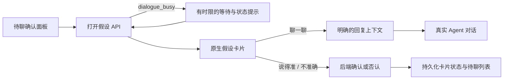
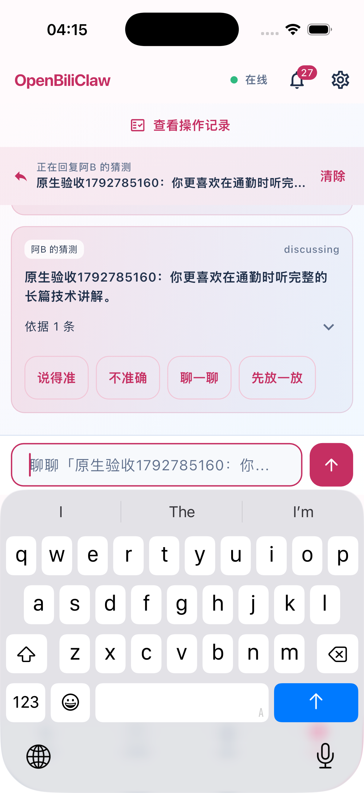

# 原生 APP 聊天与假设确认

基于原生动态来源提交 `a099a75`；后端使用 `4655c004`。本轮不修改后端配置、CLI、安装器或依赖。

## 用户操作与接口

- 普通聊天在「对话」输入并发送，使用 Agent SSE，服务端保存完整 turn。连续问答应保留同一会话的上下文。
- 点击「待聊确认」，选择一个假设并点击「放进对话」。手机使用可滚动面板，成功后自动关闭并回到聊天；宽屏内嵌面板限制高度，避免挤掉聊天区域。
- 打开待确认假设只展示卡片，不提前绑定尚未激活的讨论上下文；已经处于讨论状态的卡片和疑问条目仍恢复其上下文。
- 「说得准」确认假设；「不准确」否认假设；「聊一聊」建立该假设的明确回复上下文。发送的后续消息携带 `reply_to_turn_id`，确认或否认后解除当前输入上下文。
- 打开假设时，后端可能还在整理上一轮聊天。原生端对 `503 / detail.code=dialogue_busy` 显示“等待后台整理…”并按 1、2、3、5 秒退避，自动等待窗口为 2 分钟。窗口耗尽后提示稍后重新打开，页面仍可操作。其他 503、权限错误、状态冲突、网络中断都不自动重发。
- APP provider 销毁后停止后续重试；单个已发出的请求仍受原有 60 秒超时约束。打开面板关闭并不注销已请求的假设操作。

既有接口：`GET /chat/pending-confirmations`、`POST /chat/pending-confirmations/{ref}/open`、`GET /chat/contexts/{turn}`、`POST /chat/cards/{turn}/action`、`POST /chat/turns`、`POST /chat/agent/stream`、`GET /chat/turns/{turn}`。



## 回归覆盖

- `test/chat_view_accessibility_test.dart`：402 与 1024 宽度下展开 12 条假设仍可滚动，最后一条可打开，手机面板关闭后输入框可用；保留大字体和键盘布局回归。
- `test/chat_pending_open_test.dart`：明确忙碌后恢复、不重试其他失败、等待到期、取消后不重试、连接结果不确定时不重发。
- `integration_test/native_chat_hypothesis_live_test.dart`：启动真正 Flutter APP，以真实后端和模型完成连续聊天、假设确认、指定假设讨论、否认和普通聊天恢复。

集成用例只连接 `localhost:18612` 的隔离后端。预先在隔离画像中准备两条未验证且置信度足够的假设，分别通过 `--dart-define=CONFIRM_HYPOTHESIS=...` 和 `--dart-define=DISCUSS_HYPOTHESIS=...` 传入标题。这两条是测试初始数据，不声称由认知生成流程产生；聊天回复、状态变更与模型请求均走正式实现。

```bash
flutter test --no-pub
flutter analyze --no-pub
flutter test --no-pub integration_test/native_chat_hypothesis_live_test.dart \
  -d <iOS-simulator-id> \
  --dart-define=CONFIRM_HYPOTHESIS='<isolated fixture title>' \
  --dart-define=DISCUSS_HYPOTHESIS='<isolated fixture title>'
```

## 2026-10-24 真实验收环境与修正

- 原生 Flutter 3.47.2 / Dart 3.13.2；iPhone 17 Pro 模拟器、iOS 26.5。
- APP 使用隔离后端和真实官方 Codex app-server `gpt-6-luna` / medium。模型桥接不伪造回复或工具结果。网页仍使用后端管理的 Ego Lite；订阅源使用 HTTP。
- 假设由隔离测试数据预置，确认、讨论、否认均由原生按钮触发，状态通过正式 API 和持久化文件交叉检查。没有修改正式用户画像。
- 布局回归首先复现 12 条待确认记录造成的溢出，然后验证手机滚动面板、宽屏高度限制和选中后返回。
- 第二轮真实流程遇到后端 `dialogue_busy`，原生端原本只报错；修复后第四轮真实记录连续两次 503，随后自动重试得到 200，成功进入假设。
- 测试脚本另修正了三处验收时序：再次输入前真实点击输入框；同名消息只匹配本轮新 turn；确认/否认等待按钮操作结束后再检查上下文。前面的失败轮次不计作完整通过。
- 请求复查发现打开待确认假设会过早调用上下文接口，产生 `409 reply_target_inactive`。新增回归先复现错误提示，再修复为点击“聊一聊”后绑定；同时保留已讨论卡片和疑问条目的恢复。
- 自动化回归：166 项单元/组件测试全部通过；静态分析 0 问题；Android Debug APK 构建通过。



原始日志和模型请求审计位于本机 `/tmp/obc-native-chat-live-20261024/` 与 `/tmp/obc-native-live-20261024/bridge/`；请求可能包含测试画像和上下文，不提交原始请求。模拟器验证不等于 iPhone 真机、Android 真机或真实 Tailnet 网络验收。

### 完整聊天与假设流程：通过

第五轮整体通过；补齐上下文状态判断后，第六轮再次整体通过，执行 44 秒（不含 Xcode 构建），打开卡片无错误提示，后端没有出现提前读取未激活上下文的 409。下表为第六轮结果。

| 验收项 | 真实结果 |
|---|---|
| 普通聊天连续两轮 | 正确回复本轮临时暗号；turn `mobile-1792787126131746-owc0un` |
| 确认假设 | 卡片 `confirmation-357768a5146340cca9668f14b4894366` 为 `confirmed`；持久化 `validated=true / user_verdict=confirmed`；移出待确认列表 |
| 聊一聊指定假设 | 卡片 `confirmation-a9fcab98b399460ba6128f2f4ad94a6d` 为 `discussing`，输入区绑定该卡；模型正确解释通勤长篇技术讲解，并提出核实问题 |
| 后续回复关联 | `mobile-1792787141416694-po3owm` 的服务端 `reply_to_turn_id` 指向该讨论卡 |
| 否认讨论中的假设 | 卡片为 `rejected`；持久化 `validated=false / user_verdict=rejected`；移出待确认列表，操作完成后解除回复上下文 |
| 恢复普通聊天 | `mobile-1792787151957255-1odqxx1` 不携带假设回复目标，模型按要求回复“普通聊天恢复” |

以上同时检查了原生 provider 状态、服务端 turn、待确认列表，以及隔离画像的持久化结果。`profile-summary` 只返回有限数量的摘要，不以摘要未出现某条假设作为成功依据。

### 动态来源整轮复验：通过

原生 NGA + Atom 用例再次整轮通过，执行 2 分 29 秒（不含构建）：聊天提出新增 → 实际试跑 → APP 审批 → 来源设置调整份额 → 后台首次调度 → APP 内 Ego 接管并继续试跑 → 返回聊天 → 新增 Atom 并审批采集。

| 来源 | 独立来源 ID | 发现 / 去重后入队 | 正式运行 |
|---|---|---|---|
| NGA / Ego Lite | `custom_1d0d69fb9e4641e18875fe1226d352a4` | 3 / 2 | `ab229fe3-d310-4c4f-9f1a-e71e2463649d` |
| 阮一峰 Atom / HTTP | `custom_ddc961a7509a45368075aebbb6833279` | 3 / 0 | `3f7dd3a6-1f5f-4b7d-9705-3579d5271883` |

NGA 的份额从 1 改为 2 后读取服务端核实；两者 5 分钟间隔均已保存。本轮 Atom 命中已有候选/缓存，正常去重，不以重复入队作为成功条件。既有 Atom 内容评分入池的证据见[前一轮原生验收](native-custom-sources-live-20261024.md)。本轮验证首次自动调度，不宣称持续多小时稳定性；NGA 为公开页面，没有测试账号密码、验证码或扫码登录。

两条测试来源在结束后均已停用。原生连接偏好、隔离假设初始文件已恢复，隔离后端、临时模型桥接及本次管理的 Ego 实例已关闭。正式后端、个人画像与主工作区未修改。


## 2026-10-24 13:13 独立复测：发现未解决问题

本轮重新启动真实后端、官方 `gpt-6-luna` 桥接和原生 iOS APP；客户端为 `a327b30`，后端为 `4655c004`，运行时 Python 文件逐一比对无差异。原始证据目录：`/tmp/obc-native-repeat-20261024-131305/`。未更换模型、伪造响应或放宽既有完整场景断言。

### 普通聊天精确回忆：失败

用户本轮暗号为 `松果1792818912388`，第一轮回复正确；紧接着追问时，实际回复为 `松果1792788912388`。捕获的请求包含正确且顺序完整的最近一轮记录，排除了 APP 未提交和历史缺失。原始请求单独重放三次均复现同样错误。仅保留最近一轮、或保留完整历史并再次明确列出最近一轮，两种诊断变体分别得到正确回复。

结论：大量相似历史记录下，当前模型和上下文组织组合存在可复现的精确回忆错误。诊断变体没有写入生产实现，因此本轮不能宣称此问题已修复，也不能把后续成功当作首次整体通过。

### NGA 聊天新增：未通过

原生请求 `mobile-1792819089641283-1pa59r7` 实际调用了来源准备工具；草稿 `a9ada93e-6142-4ccb-bf2d-dd1a8673629c` 停在 `needs_details`，没有提交激活审批。模型理由为观测页面不匹配入口、存在子版块内容。

随后通过正式接管接口独立观察和截图，页面标题确实是“二次元国家地理 NGA玩家社区”。观测 URL 为 `https://bbs.nga.cn/thread.php`；当前快照会移除查询参数，因此没有 `fid=-447601`。这是潜在误判来源，但重新观察后，原始提示与补充脱敏说明的提示均能生成方案，尚不能断言仅查询参数脱敏导致失败。诊断生成的方案未激活，不计作端到端通过。

新增 `integration_test/native_followup_live_test.dart`，分别验收假设操作和 Atom 来源，避免普通聊天或 NGA 的失败遮住这些独立功能。原来的两组整体用例及严格断言保留。

### RSS 独立补测：通过

在同一个原生 APP 中独立完成 Atom 来源自然语言新增、真实模型准备、原生审批和后台自动采集。来源 `custom_61c23f4643f5468394226cad495d5f2f`，正式运行 `e44bfb67-e0e4-4b19-8749-2a4191a13bad`，HTTP 执行器发现 3 条、去重后入队 0 条，状态 `ok`。这些条目在隔离库中已有记录，未绕过去重或评分。结束后停用测试来源。

### 假设补测中的脚本修正

第一轮独立补测已成功确认假设，但随后脚本仍等待另一条假设出现在待聊列表。服务端记录表明，该假设早已由后台挂在聊天中（卡片 `confirmation-2d8776cd6638506a9b16bf6ab1934c5b`，`pending`），所以待聊列表不再重复展示。修正共用测试助手：若未结算卡片已经在聊天中，滚动定位该卡片并继续操作；否则仍从待聊列表打开。保留已结算卡片不能充当新待确认记录的限制。原生产品代码未因此修改。

本轮没有重新构建 Android 或运行真机；新增/调整的集成测试通过 Flutter 静态分析。完整旧用例的失败日志和独立补测结果分别保留。

### 假设独立最终补测：通过

重新准备独立的两条测试假设后，原生用例在 37 秒内完成（不含构建）：

- 确认卡 `confirmation-88a0b981007247eabe27e9f7e9bd439a`，持久化 `validated=true / user_verdict=confirmed`。
- 讨论卡 `confirmation-3083f28371124f418aeb01b5c2d557d9`，模型准确围绕该卡的通勤长篇技术内容提问；回复 `mobile-1792819861654443-oopasf` 的关联目标正确。
- 否认后卡片为 `rejected`，持久化 `validated=false / user_verdict=rejected`；移出待确认列表，解除输入上下文。
- 普通聊天恢复 turn `mobile-1792819875152179-1nw8jru` 不再携带假设目标，回复“普通聊天恢复”。

结论：本轮假设确认/讨论/否认和 Atom 新增采集分别通过；长历史精确回忆和 NGA 新增未通过，两个问题尚未修复。测试来源已停用，模拟器偏好与隔离画像基线恢复，临时后端、模型桥接和本轮 Ego 实例关闭。

独立复跑入口（准备新的测试假设后）：

```bash
flutter test --no-pub integration_test/native_followup_live_test.dart \
  -d <iOS-simulator-id> \
  --dart-define=CONFIRM_HYPOTHESIS='<isolated fixture title>' \
  --dart-define=DISCUSS_HYPOTHESIS='<isolated fixture title>'
```

该入口用于隔离诊断，不替代前述完整场景，也不证明普通聊天精确回忆或 NGA 新增已恢复。
