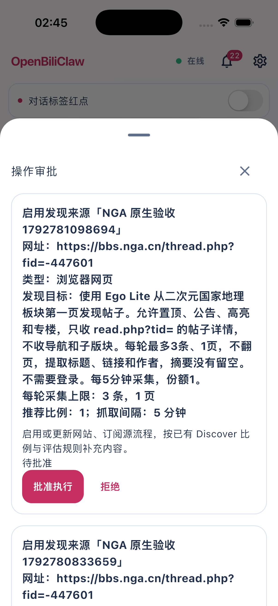
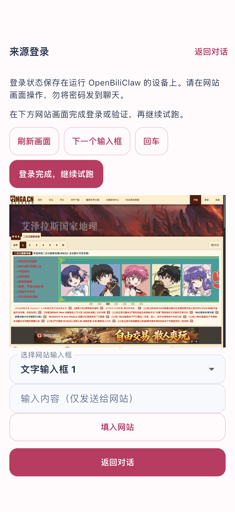

# 原生动态来源实测（2026-10-24）

原生实现：`feat/native-dynamic-sources`，基于 Flutter 客户端 `dfe340a`。后端隔离运行时来自 `fix/mobile-source-login-return` 的 `e8713708`（`9634b6e2` 仅补文档），登录补验另应用 `fix/native-source-session-lifecycle` 的 `4655c004` 会话释放/复用补丁。未修改正式服务和个人主工作区。

## 真实环境

- Flutter 3.47.2 / Dart 3.13.2，iPhone 17 Pro 模拟器，iOS 26.5。
- 原生 APP 连接隔离后端 `localhost:18612`，不是 PWA 或移动网页。
- 真实官方 Codex app-server `gpt-6-luna` / medium，经临时兼容接口转发原始请求和工具调用；未伪造模型响应、抓取结果或评分。
- 网页来源运行在后端管理的 Ego Lite。没有用 Playwright 替代；Atom 来源使用 HTTP 执行器。
- 本轮没有使用真实 NGA 账号，验证的是公开页面接管、真实截图、继续试跑及返回对话；账号密码、验证码和扫码登录仍需要专门账号场景验收。

## 完整原生流程

`integration_test/native_custom_sources_live_test.dart` 第三轮整体通过（2 分 1 秒，不含构建）：

1. 在原生「对话」输入 NGA 来源、范围、每轮 3 条、5 分钟和 1 份占比。
2. 真实模型准备流程，Ego 实际试跑；原生审批卡点击批准，轮询到 `executed`。
3. 原生设置 → 自定义来源，份额修改为 2；读取服务端确认持久化。
4. 等后台调度实际抓取，检查正式运行记录。
5. 点击重新登录，进入 APP 内原生 Ego 接管界面，继续实际试跑并返回聊天。
6. 在同一原生聊天新增阮一峰 Atom 来源，试跑、原生审批、后台首次采集。
7. 停用本次测试来源，恢复模拟器原有连接偏好。

| 来源 | 独立来源 ID | 执行器 | 正式发现 / 入队 | 后续评估 |
|---|---|---|---|---|
| NGA 原生验收 | `custom_655cd7fbba1c402cb16d5ddc099792c6` | ego | 3 / 1 | 新内容相关性 0.22，正常过滤 |
| RSS 原生验收 | `custom_bf7b60cf51c241cf901e16d7aaedf1f5` | http / feed | 3 / 1 | 《科技爱好者周刊（第 414 期）：Jev 决策模型有什么用》，相关性 0.61，`cached` 入池 |

两条新候选都保留各自的 `source_id` 和 `source_name`。发现数包含已有内容，去重后入队数量可更少；通过评分的内容才入池，没有为测试绕过推荐规则。5 分钟配置已持久化，本用例验证调度器首次自动执行，不声称持续多小时稳定性。

NGA 正式运行：`2ac6a6f0-a6a7-426f-880d-3cb8c1c33d85`；Feed 正式运行：`9ca4114b-39d5-4e9c-96c1-ca47273f3a04`。

## 失败记录与修正

- 第一轮：复制临时模型桥接目录时漏建工作目录，模型进程启动失败；APP 显示失败且未创建来源。补齐目录后，以真实模型请求确认恢复。
- 第二轮：NGA 已实际新增、审批启用并采集；测试自动化在来源设置按钮尚未滚入屏幕时点按失败。修正原生测试，必须等待布局并确认命中可点击区域，再点击。未把这一轮算作整体通过。
- 第三轮：完整流程通过。额外修正截图加载期间的高度跳动、未运行时间显示 `0.0` 以及浅色状态栏文字。视觉补验发现被动截图刷新会临时禁用按钮，已将其与用户操作分开，并丢弃过期截图；补充并发回归和独立原生实测。
- 视觉补验第二轮：上一轮中止留下活跃登录窗口，新草稿碰到同来源会话锁。新增后端幂等关闭接口，原生页面退出主动释放；同来源重复登录复用活跃草稿，后端回归验证关闭不发布、不改变原有策略。

- 登录生命周期补验：真实原生页面退出后，原截图接口返回 409；再次进入创建新草稿，真实 Ego 重新打开并继续试跑成功。重复打开活跃窗口返回同一草稿。

- 最终视觉用例等待 `RawImage` 实际绘制后再截图，确认 NGA 网站像素出现在原生页面；并完成退出释放、重开和试跑（30 秒左右，不含构建）。此前仅检查图片尺寸的截图过早，未作为最终视觉证据。

## 自动化检查

- `flutter analyze --no-pub`：0 问题。
- `flutter test --no-pub`：159 项全部通过，包含被动截图与用户操作并发、认证 / Tailnet 复用、审批状态、来源健康与归属。
- iOS 原生完整流程：NGA + Atom 整轮通过。
- Android Debug APK：构建通过。
- 后端关联回归 112 项通过，Ruff 通过，MyPy 352 文件通过。后端全量套件运行 6 分 5 秒、975 项通过后主动中止；不声明后端全量通过。

## 本机证据与复跑

原始记录：`/tmp/obc-native-live-20261024/`，包括三轮 Flutter 日志、后台日志、真实模型请求审计和截图。模型审计可能包含测试画像和上下文，因此不提交原始请求文件。

```bash
flutter analyze --no-pub
flutter test --no-pub
flutter build apk --debug --no-pub
flutter test --no-pub integration_test/native_custom_sources_live_test.dart -d <simulator-id>
flutter test --no-pub integration_test/native_source_login_live_test.dart -d <simulator-id> \
  --dart-define=NATIVE_SOURCE_ID=<isolated-test-source-id>
```

`native_source_login_live_test.dart` 是完整聊天测试后的视觉补验：真实后端草稿、Ego 截图、非零原生图片尺寸、截图保存、真实继续试跑。只对隔离测试来源运行。

Android 验证范围为 Debug APK 构建；没有宣称 Android 真机、iPhone 真机或真实 Tailnet 网络端到端通过。Cookie、basePath 与 Tailnet 客户端复用有单元回归覆盖。未合并到 main、未发布商店版本。

## 原生界面截图




