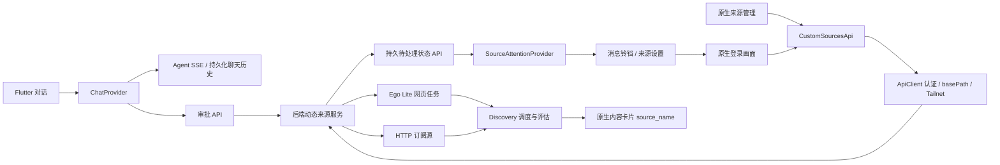

# 原生 APP 自定义 Discovery 来源

Flutter 客户端对接动态来源后端（包含后端提交 `4655c004` / 分支 `fix/native-source-session-lifecycle` 的接口）；旧后端没有此接口时会显示加载错误。网页发现运行在后端管理的 Ego Lite，手机无需安装浏览器执行器。公开 RSS、Atom、JSON Feed 由后端 HTTP 执行器处理。

## 用户流程

输入框上方常驻「添加来源 · 说明与示例」，打开后用简短说明和网站／RSS 两个自然语言示例介绍此功能，标明试跑确认、来源管理与异常历史位置。
键盘或横屏空间较小时入口缩为带相同辅助标签的链接图标；说明面板支持大字体、滚动与关闭，不修改草稿或自动发送。

1. 在「对话」描述想添加的网站或订阅源、地址和内容要求。Agent 补问必要信息并实际试跑。
2. 需要登录时，点击对话中的登录链接或「在 APP 中登录来源」。原生页面展示后端 Ego 画面，可点击、输入、按 Tab / Enter，完成后继续试跑并返回对话。登录内容直接传给后端操作接口，不进入聊天消息。
3. 点击「操作审批」，阅读摘要与影响后批准。`executing` 表示后台执行中，只有 `executed` 才表示完成；拒绝不会启用来源。最近 50 条操作记录保留最终状态和执行结果，重开 APP 后仍可回看。
4. 连接设置 →「自定义来源」可修改名称、1–20 份占比、5–10080 分钟间隔，启停、归档、重新登录、查看任务与运行记录。归档保留历史归属。
5. 采集遇到登录失效或网站安全验证，后台暂停该任务，消息铃铛和来源设置显示原因；点击处理进入原生接管，成功试采后才恢复。停用或归档来源可隐藏提醒，重新启用仍须处理验证。
6. 推荐、惊喜推荐、收藏及内容历史优先显示独立 `source_name`，缺失时回退平台名称。采集和后续内容评估由后端调度；发现数、入队数和推荐入池数不是同一个指标。

## 接口与模块

`ChatView` 的来源说明为本地 UI，不增加接口、依赖或建源权限；实际添加仍使用下面的聊天、试跑和审批链路。

- `api/chat_api.dart`：`POST /chat/turns` 创建持久化 turn；优先 `/chat/agent/stream`，仅在未收到事件且接口返回 404/503 时回退旧 `/chat/stream`。断流后查询同一 turn，不重复提交。
- `models/chat.dart`：`ChatTurn.sourceLoginLinks` 从持久化 `agent_events[].text` 解码 `needs_login/takeover_url`，兼容旧 `data.text` 包装并去重；无效 JSON 不产生入口。聊天按钮不依赖模型把 URL 写成 Markdown，仍由 `CustomSourcesApi.loginDraftId` 限制到自身后端。
- `providers/chat_provider.dart`：审批列表与执行状态同步，操作期间禁止重复提交；支持 `delta`、`final`、`done` 事件。
- `widgets/chat_approvals.dart`：审批入口、摘要、影响、批准/拒绝和执行状态。
- `api/custom_sources_api.dart`：来源列表、PATCH 修改、DELETE 归档、运行记录、Ego 准备、登录草稿、接管、截图、操作及继续试跑。复用客户端认证 Cookie、URL 前缀与 Tailnet 客户端。
- `api/client.dart`：普通请求到期取消，实际请求结束后释放独占客户端，避免 iOS 关闭异常覆盖超时；共享 Tailnet 连接保持可用，详见 [HTTP 生命周期](native-http-lifecycle.md)。
- `views/custom_sources_view.dart`：加载失败保留最后成功列表；展示 `health` 下的状态、错误及时间。
- `views/source_login_view.dart`：原生表单及 Ego 截图控制。后台/退出停止截图轮询，退出调用幂等 `/drafts/{id}/close` 释放窗口；同一来源的活跃登录窗口由后端复用，避免断连后自锁；被动截图不阻塞用户操作，旧截图不能覆盖新的操作结果；失败后显式重开；同源接管链接转为原生页面，不把后端 Cookie 传到外站。跨域登录按后端发现的登录域名单显式允许。

登录／验证域选项优先消费 snapshot 的 `suggested_login_origins`；旧后端缺少该字段时才回退
`blocked_navigation_origins`。最新列表替换旧按钮，不累积已授权或过期域名。明确验证页的
iframe 可由后端列为候选，原生 App 只通过“允许此登录或验证页面”逐域提交；不从原始
`blocked_frame_origins` 自行推导或授权，也不点击网站验证码。

此变更没有新增后端配置字段、CLI、安装器步骤或 Flutter 第三方依赖。实际网站登录仍可能要求账号、验证码或扫码；NGA 公开内容验收不代表完成了账号登录验收。

## 验证

来源说明（2026-11-07）：`test/chat_source_guide_test.dart` 覆盖普通手机、320×568／3.2 倍文字／深色和横屏，验证说明滚动、草稿保留和关闭后发送；与 `chat_view_accessibility_test.dart` 共 6 项通过。Flutter 全量 191 项和静态分析通过。中文字体组件渲染用于核对展示，未为本次说明重新构建安装包或重跑建源真实请求。

2026-11-06 后续验证域修复：在独立 worktree（基线 `379cfcc`）重新构建 iOS App，
`native_verification_scope_live_test.dart` 用 25 秒完成真实待验证草稿 → 显示
Cloudflare 域授权按钮 → 原生点击 → 后端持久授权 → Ego 验证框加载 → 退出释放。
隔离 API 18614 使用后端 `fix/ego-verification-scope-20261106` 的真实来源路由，
真实 Ego Lite 0.6.2.7；该场景没有模型调用，不是重新完成聊天建源、作品采集或账号登录。
授权后哔哩轻小说仍停在网站验证页，后端继续试跑维持 `needs_login`，启用返回 422，
0 来源／0 workflow／0 正式运行。原生两张截图均已核看；验证框加载不等于验证通过。
常规测试 170 项、最终静态分析通过；原生环境为 iPhone 17 Pro / iOS 26.5 模拟器，
不是物理手机或 Android。后端完整记录为
`docs/testing/2026-11-06-bilinovel-proxy-verification.md`。未合并、推送或发版。

完整流程、运行记录和边界见 [2026-10-24 原生实测](native-custom-sources-live-20261024.md)。

2026-11-06：真实 V2EX 聊天返回了 `needs_login/takeover_url`，但持久化事件的顶层 `text` 未被旧客户端解析，导致接管按钮缺失。根据实际事件补的回归先失败，再修复；常规测试 168 项通过。在 iPhone 17 Pro / iOS 26.5 模拟器重新构建后，真实聊天新增 → 点击接管按钮 → 显示后端 Ego Lite 0.6.2.7 的验证画面 → 继续试跑仍保持待验证、未启用来源 → 返回对话，整轮 63 秒通过。模型使用已授权的官方 GPT-6 Luna CLI 兼容桥，无回放响应。网站本身的安全验证尚未完成，这轮不计作 V2EX 正式采集或账号登录通过；也不是物理手机验收。截图 SHA-256 为 `4b23ab5608c8780d47a42550df01da43caec0dd79810e5ff977231c76ebec7f2`，原图与临时 harness 保存在私有证据目录。后端修复及 BBC / Planet Python 的实际采集结果见 OpenBiliClaw 仓库 `docs/testing/2026-11-06-remaining-sites-fixes.md`。

常规：`flutter analyze`、`flutter test`。

本轮两项均通过：`flutter analyze --no-pub` 无问题，`flutter test --no-pub` 168 项通过；本轮临时真实测试代码已从工作树移除，原始证据单独保留。

真实原生用例：`flutter test integration_test/native_custom_sources_live_test.dart -d <iOS-simulator-id>`。仅连接本机隔离后端 `localhost:18612`，需要真实模型和已管理的 Ego Lite。创建唯一名称的测试来源，按 UI 批准、修改份额、检查后台采集、进入原生接管页继续试跑并返回聊天。同轮还通过原生聊天新增 Atom 订阅源、审批并检查真实定时采集。测试结束恢复模拟器偏好；测试来源在成功后停用，失败时应检查并停用本次创建的来源。不要对个人正式后端运行此用例。

`SourceAttentionProvider` 通过 `GET /custom-sources/attention` 同步当前提醒，按 id 去重。
前台每 30 秒及打开消息／更新来源后刷新；后台停止定时器，恢复立即请求。
读取失败保留上次提醒，成功空列表才清空；切换后端拒收旧响应。
`source_login` 调用已有来源 login 接口，`draft_login` 读取原草稿；原生登录完成后刷新提醒。
这是应用内提醒，未增加系统推送、邮件或后台通知服务。

本轮 App 实测发现 `HomeView` 构建时同步启动提醒刷新会触发 Provider 构建期通知异常。
新增 Widget 回归复现后，首轮刷新改为 microtask，后台停轮询和页面恢复行为保留。
常规 175 项测试与静态检查通过；真实 Rust／Django RSS 复跑记录由后端验收文档汇总。

## 连续故障与异常记录（2026-11-06，未发布）

普通采集连续失败 3 次时，消息铃铛显示 source_settings 提醒，直接打开对应来源；
登录／验证仍立即提示并走原接管页。来源卡显示安全原因与重试时间，普通故障不显示登录按钮。
当前提醒按来源合并，一个 workflow 恢复不会清除其他任务的问题。

「设置 → 异常记录」和来源页的历史按钮共用 `DiagnosticsApi.list()`，读取
`GET /api/diagnostics/alerts`。来源历史按 source_id 过滤，故障与“已恢复”分别显示；
点击“查看来源”只导航，不自动重试／登录。历史页前台每 15 秒及恢复前台刷新，
进入后台或打开来源页后停止计时；断线或 source_history_available=false 时保留已有记录。
后端保留最近 500 条来源转移，重启后可读；原 LLM／Embedding 记录仍仅在服务进程内保存。

专项原生验收用例为 `native_source_failures_live_test.dart`，用真实 API 和隔离故障控制进程验证
铃铛 → 来源卡 → 失败／恢复历史 → 当前提醒清除 → 设置入口。控制过程有明确的失败和时钟注入，
恢复采集使用公开 RSS；不等同于自然网站故障、完整聊天建源或自然定时周期。

最终 iPhone 17 Pro / iOS 26.5 模拟器安装验收 58 秒通过，包含恢复后消息清除及设置入口。
后端真实 Django RSS 取得 3 条并入队；后续同文重采 3 条／新增 0 条，仍正常恢复。
常规测试 178 项通过，analyze 无问题；来源卡和恢复记录截图已核看。
测试脚本曾因未交接候选、误用 bottom sheet 返回按钮而失败，修正后完整重跑，不把中途成功
当作整轮通过。后端完整记录：docs/testing/2026-11-06-source-failure-alerts.md。

2026-11-08 组合复验：真实原生网页／RSS 聊天建源、审批、份额、Ego 截图返回与两轮自然调度 7 分 53 秒通过；原生聊天假设及来源故障恢复专项也通过。详见 [真实驱动记录](native-live-driver.md#2026-11-08-后台-ego-组合复验)。
