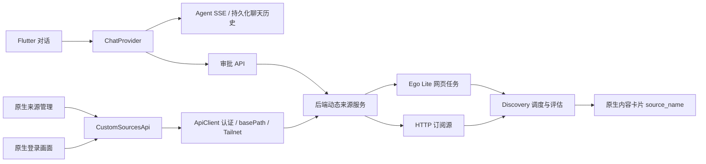

# 原生 APP 自定义 Discovery 来源

Flutter 客户端对接动态来源后端（包含后端提交 `4655c004` / 分支 `fix/native-source-session-lifecycle` 的接口）；旧后端没有此接口时会显示加载错误。网页发现运行在后端管理的 Ego Lite，手机无需安装浏览器执行器。公开 RSS、Atom、JSON Feed 由后端 HTTP 执行器处理。

## 用户流程

1. 在「对话」描述想添加的网站或订阅源、地址和内容要求。Agent 补问必要信息并实际试跑。
2. 需要登录时，点击对话中的登录链接或「在 APP 中登录来源」。原生页面展示后端 Ego 画面，可点击、输入、按 Tab / Enter，完成后继续试跑并返回对话。登录内容直接传给后端操作接口，不进入聊天消息。
3. 点击「操作审批」，阅读摘要与影响后批准。`executing` 表示后台执行中，只有 `executed` 才表示完成；拒绝不会启用来源。最近 50 条操作记录保留最终状态和执行结果，重开 APP 后仍可回看。
4. 连接设置 →「自定义来源」可修改名称、1–20 份占比、5–10080 分钟间隔，启停、归档、重新登录、查看任务与运行记录。归档保留历史归属。
5. 推荐、惊喜推荐、收藏及内容历史优先显示独立 `source_name`，缺失时回退平台名称。采集和后续内容评估由后端调度；发现数、入队数和推荐入池数不是同一个指标。

## 接口与模块

- `api/chat_api.dart`：`POST /chat/turns` 创建持久化 turn；优先 `/chat/agent/stream`，仅在未收到事件且接口返回 404/503 时回退旧 `/chat/stream`。断流后查询同一 turn，不重复提交。
- `providers/chat_provider.dart`：审批列表与执行状态同步，操作期间禁止重复提交；支持 `delta`、`final`、`done` 事件。
- `widgets/chat_approvals.dart`：审批入口、摘要、影响、批准/拒绝和执行状态。
- `api/custom_sources_api.dart`：来源列表、PATCH 修改、DELETE 归档、运行记录、Ego 准备、登录草稿、接管、截图、操作及继续试跑。复用客户端认证 Cookie、URL 前缀与 Tailnet 客户端。
- `views/custom_sources_view.dart`：加载失败保留最后成功列表；展示 `health` 下的状态、错误及时间。
- `views/source_login_view.dart`：原生表单及 Ego 截图控制。后台/退出停止截图轮询，退出调用幂等 `/drafts/{id}/close` 释放窗口；同一来源的活跃登录窗口由后端复用，避免断连后自锁；被动截图不阻塞用户操作，旧截图不能覆盖新的操作结果；失败后显式重开；同源接管链接转为原生页面，不把后端 Cookie 传到外站。跨域登录按后端发现的登录域名单显式允许。

此变更没有新增后端配置字段、CLI、安装器步骤或 Flutter 第三方依赖。实际网站登录仍可能要求账号、验证码或扫码；NGA 公开内容验收不代表完成了账号登录验收。

## 验证

完整流程、运行记录和边界见 [2026-10-24 原生实测](native-custom-sources-live-20261024.md)。

常规：`flutter analyze`、`flutter test`。

真实原生用例：`flutter test integration_test/native_custom_sources_live_test.dart -d <iOS-simulator-id>`。仅连接本机隔离后端 `localhost:18612`，需要真实模型和已管理的 Ego Lite。创建唯一名称的测试来源，按 UI 批准、修改份额、检查后台采集、进入原生接管页继续试跑并返回聊天。同轮还通过原生聊天新增 Atom 订阅源、审批并检查真实定时采集。测试结束恢复模拟器偏好；测试来源在成功后停用，失败时应检查并停用本次创建的来源。不要对个人正式后端运行此用例。
