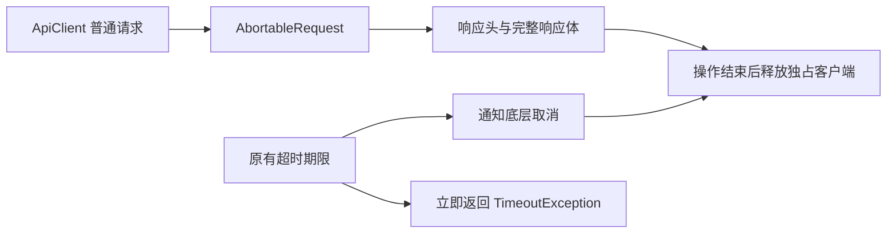

# 原生 HTTP 请求超时与资源释放

2026-11-07 的 iOS 真实聊天验收在页面捕获 `cannot close with running requests`。
原生库 `CupertinoClient` 在 NSURLSession 任务仍运行时拒绝 `close()`；原来的
`Future.timeout()` 只停止等待，外层 `finally` 却立即关闭客户端，覆盖了原始超时。

## 已实现行为与接口

`ApiClient.get/post/patch/put/delete/getBytes/checkHealth` 的公开参数、默认超时与返回值不变。
普通 HTTP 请求统一使用 `AbortableRequest`，完整等待响应头和响应体。达到原有期限时，
立即向调用方返回 `TimeoutException`，同时通知底层取消；实际操作完成或取消后才释放
本次独占客户端。迟到响应只完成释放，不再更新会话 Cookie 或调用方结果。

Tailscale 借用的共享客户端仍由 Tailscale 管理，单次请求不得关闭它；原有幂等 GET
传输故障重试保持不变。Agent SSE 保留现有流式客户端及流的取消行为。
没有增加依赖、后端接口、配置项、CLI 或安装步骤。

## 回归与真实验证

- `test/api_client_lifecycle_test.dart`：超时取消、延迟取消、响应体中途超时、成功响应、
  迟到响应不更新 Cookie；覆盖 GET、POST、PATCH、PUT、DELETE 与图片字节请求。
  首个回归在旧实现返回相同的 `StateError`，修复后返回预期超时。
- `test/api_client_test.dart`：共享 Tailscale 生命周期、重试、认证及 URI 约定。
- `integration_test/native_source_http_lifecycle_live_test.dart`：先在原生 App 内启动
  私有 loopback HTTP 服务，确认请求真实到达，再分别延迟响应头／响应体触发原有取消路径，
  验证随后成功请求正常。继续运行 `native_custom_sources_live_test.dart` 的完整建源流程。
  该服务仅存在于集成测试，不进入产品后端。

完整建源测试在输入后确认文本并等待布局，再点击实际可点击的发送按钮；审批、真实网页／RSS
采集、份额以及两个自然采集周期的断言和时间窗口保持不变。
实际设备、模型、执行器、成功与失败次数以 [原生 driver 验收记录](native-live-driver.md) 为准。
