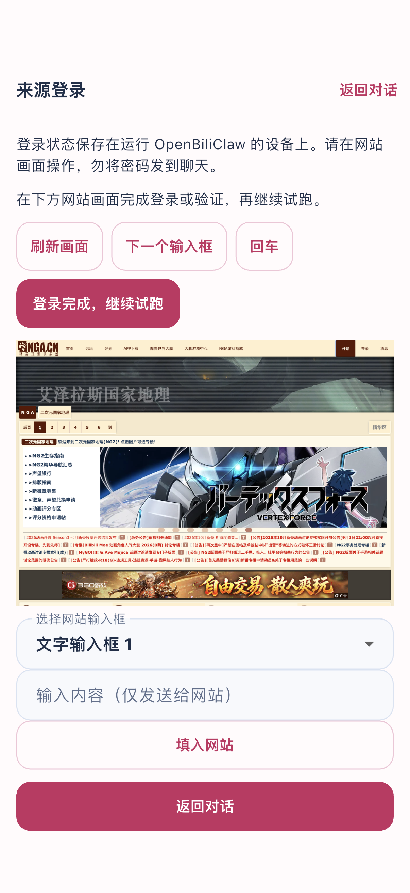

# 原生真实复测与修复（2026-10-25）

本轮在 `fix/native-live-regression-verification`（基于 `18cf734`）继续真实验收；配套后端为 `fix/native-live-regression-fixes`。Flutter 3.47.2 / Dart 3.13.2，iPhone 17 Pro 模拟器，iOS 26.5，连接隔离的 `localhost:18612` 后端。

模型为真实官方 Codex app-server `gpt-6-luna` / medium；网页使用后端管理的 Ego Lite 0.6.0.16，Atom 使用 HTTP。没有以 Playwright 替代网页来源，没有伪造模型回复、采集内容或评估结果。

## 本轮发现和修正

1. 后端将完整有界聊天历史区分为较早记录和最近一次用户发言及其后续记录，修复大量相似暗号历史下的精确回忆错误。原始失败请求真实重放三次均恢复，另两种变体通过。
2. 后端明确脱敏 URL 的含义，区分网站追加查询参数与更改入口，并提供原始 href 前缀证据，修复 NGA 来源准备误判。
3. 后台采集最小化 Ego 窗口后，原生接管截图原先返回 500。后端 `85d95f56` 恢复当前自有人工会话窗口并等待就绪；并发最小化仅有限重试，持续失败返回可诊断 409。
4. 原生集成脚本在滚动查找尚未构建的假设卡时，提前对空 finder 使用 `.last` 抛错。改为可为空的文本 finder 交给 `scrollUntilVisible`，保留原有严格断言；原生产品代码未因此修改。
5. 后端来源计划出现行筛选与真实 href 表示不一致。`d21144b3` 用严格同源、同路径、同字段的真实 DOM 证据修正草稿，在同一失败草稿上正式试采得到 3 条真实帖子；仅改变相对/绝对 href 表示。随后新鲜原生整轮又生成无效的嵌套 `:has()`，保持失败且没有激活，不能把前一份草稿恢复称为新建来源全流程通过。
6. 后端 `c62df4a3` 增加无效 CSS 的诊断、生成提示约束和有界结构修正；真实行／链接证据与严格审核全部通过才保存。`9a1e4817` 将新采集网页内容明确标为 `article`，真实新 NGA 候选已核对，旧记录不迁移。

另一次聊天测试因新旧预置假设正文相同、只改时间戳，被正常近似去重合并。纯函数重放已确认原因，生产去重未改；后续改用语义不同的测试记录。预置记录仅验证假设交互，不声称验证了自动生成假设。

## 原生 Ego 视觉补验：通过

`native_source_login_live_test.dart` 在 `85d95f56` 后端上整轮通过，执行 41 秒（不含 Xcode 构建）。使用本轮已成功创建且停用的独立来源 `custom_380b838045bc4440a5a99b1d443c56db`：

- 原生页面加载真实 NGA 图像，等待 `RawImage.image` 非空，显示尺寸为 370 × 260.2 逻辑像素。
- 操作“下一个输入框”后截图继续正常。
- 重复进入活跃接管复用草稿；退出后截图接口返回 409，证明会话已释放。
- 重新进入使用新草稿，真实 Ego 截图与继续试跑成功。

## 最终 NGA＋Atom 新增整轮：通过

最终后端 `9a1e4817` 上，`native_custom_sources_live_test.dart` 的原有严格断言全部通过：执行 2 分 22 秒，另有 Xcode 构建 58.9 秒。日志为 `sources-structural-final-e2e.log`。

- NGA：聊天 turn `mobile-1792910598538048-wsqmkf` → APP 审批 `ap_3f1c5344d7894d80` → 独立来源 `custom_ee17be92bbfb4fb5848d840c7ccbb6d7` → 设置页份额 1 改为 2 → 自动 Ego 采集发现 3／入队 1 → 原生接管截图就绪 → 继续真实试跑 → 返回聊天。
- 随后同一用例新增 Atom：APP 审批后来源 `custom_3273e59c80bc495bb6e5ae29afa233ec` 自动 HTTP 采集发现 3／入队 0（已有内容正常去重）。
- 正式运行分别为 `dc1e327c-1f0b-4c19-a3a5-e27a71111954` 和 `a995bba0-ee4a-465a-9fda-b7ec108298b2`；两个测试来源均已停用。NGA 新候选正常低分拒绝；真实入池证据来自下文另两次周期调度，不混算。

限制：先前那份嵌套错误草稿的诊断审核曾通过，但正式 `/trial` 仍被语义审核拒绝，保持失败且未启用。原计划没有明确固化 `tid` 查询条件，审核还错误理解了“允许高亮”。不能声称所有失败草稿均可自动修复；有时仍需重新准备草稿。最终新建整轮的通过与这个限制分别记录。

## 完整聊天与假设流程：通过

`native_chat_hypothesis_live_test.dart` 在 `85d95f56` 后端上整轮通过，执行 51 秒（不含构建）。此前脚本错误和重复 fixture 的失败轮次保留，不混算通过。

| 验收项 | 结果 |
|---|---|
| 普通聊天回忆 | `mobile-1792906738210336-3hsx6j` 准确回复本轮暗号 |
| 确认假设 | `confirmation-46be376a55114da6bbe6a3cce88bbf8f` 为 `confirmed`；画像 `validated=true / user_verdict=confirmed` |
| 指定假设聊一聊 | 回复 `mobile-1792906758732912-lzlclx` 正确关联 `confirmation-79b191137e144ec8b3482682c88c1615`，围绕通勤候车阅读古代天文史讨论 |
| 否认 | 讨论卡为 `rejected`，画像 `validated=false / user_verdict=rejected`，不再出现在待确认列表 |
| 普通聊天恢复 | `mobile-1792906769310504-18iwbva` 无假设回复目标并回复“普通聊天恢复” |

期间实际出现后台整理中的 `dialogue_busy` 503，原生自动退避等待恢复为 200。验证同时覆盖 APP 状态、正式 API 和画像文件，不以 UI 提示作为唯一成功依据。

## Atom 独立验收：通过

独立 Feed 用例整轮通过（71 秒，不含构建）：聊天新增 → 真实模型准备 → 原生审批 → 后台自动采集。来源 `custom_2718ed79fc554224b8d4cfb416cb14bf`，正式运行 `84d9735b-2bb0-4927-a40f-f0d394d1a479`，HTTP 发现 3 条、去重后入队 0 条；三条均在隔离库中已有候选记录，未重复入队。

## 周期调度与入池补验：通过

通过 API 临时重新启用已由 APP 新增、审批并设置为份额 2／5 分钟的 NGA 测试源，未手动触发采集或调整时钟。两个正常周期均使用 Ego 成功完成，分别发现 3／入队 2 与发现 3／入队 1；第二轮在前一轮结束后 300.062 秒自动开始，随后已停用。日志为 `periodic-watch.log`。

其中真实帖子 `47780992` 获模型评分 0.62，候选变为 `cached`，正式推荐 API 返回推荐 9，保留独立来源 `custom_380b838045bc4440a5a99b1d443c56db`、来源名称、流程版本和运行记录。此项验证后端真实入池与 API 归属，不额外声称已点击 APP 中的推荐卡。

## 证据和范围

本机原始证据位于 `/tmp/obc-native-fixes-20261025-125407/`。真实请求可能含隔离测试画像和聊天上下文，不提交原始模型请求。本轮 NGA 只测公开页面接管，不包括账号密码、验证码或扫码。模拟器结果不代表 iPhone/Android 真机或真实 Tailnet 网络验收；本轮没有发布商店版本。

原生单元测试 166 项通过，Flutter analyze 无问题。后端完整套件 11,403 项通过、72 项跳过；该套件从 `35311dbd` 启动，运行过程中集成后续补丁，因此配合差量回归报告，不声称它是最终 HEAD 的独立冻结验收。`d21144b3` 对应的 195 项关联测试、Ruff 和 MyPy（352 个源文件）通过。

最终 `9a1e4817` 的 246 项关联测试通过，最终全仓 Ruff 和 MyPy（352 个源文件）通过。

本轮新增 4 个测试来源全部停用，原有 10 个来源的策略配置未变。后端退出后恢复隔离画像，临时后端、Luna 桥接和自有 Ego 已停止，历史证据保留。最终成功用例恢复了自身偏好，但不推断早期中断轮次前的全部模拟器偏好均已还原。修复留在独立分支，未合并或发布。
